  

## 👋 Hi, I'm Gabriel

I like turning problems into code that works, is easy to maintain, and doesn't break on a Friday afternoon.
I work with **C#, Python, C++ and TypeScript**, build interfaces with **React**, and handle data with **SQL and MongoDB**.
I also enjoy automating anything repetitive: pipelines, infrastructure, and tests.

- 🔭 Currently going deeper into **AWS + Terraform**, testing everything locally with **LocalStack**
- 🧪 I believe automated tests are part of the code, not an extra
- 🐧 Moving to **Linux (Fedora)** and learning **Vim** (still figuring out how to exit it)
- 💬 Happy to chat about code, architecture, or projects

---

### 🧰 Languages & front end

  
  
  
  
  

### 🗄️ Databases

  
  

### 🔁 Version control & CI/CD

  
  
  

### ☁️ Cloud, infrastructure & testing

  
  
  
  

### 🌱 Currently learning

  
  

---

<i>"Works on my machine" is not an acceptance criterion. 😄</i>

 
